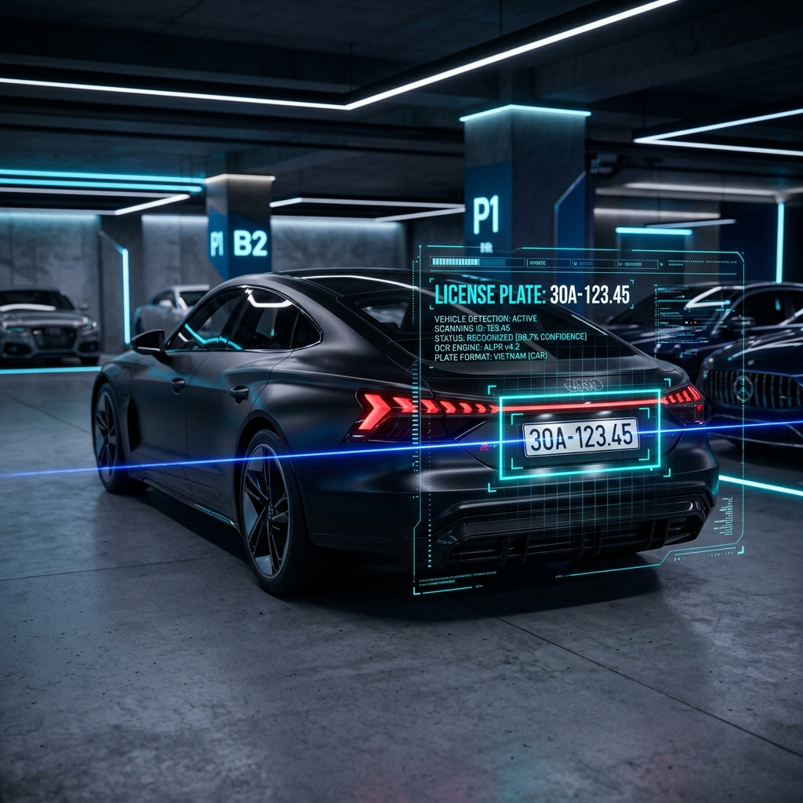
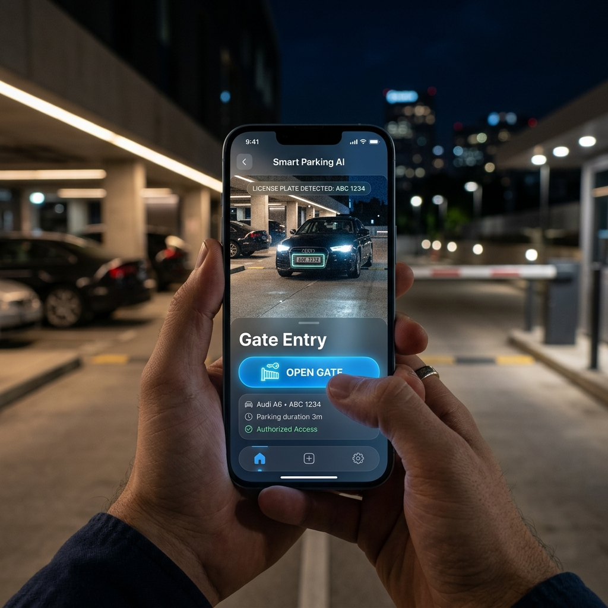

# 🚀 Cách mạng hóa quản lý bãi xe với Camera AI thông minh

Trong kỷ nguyên chuyển đổi số, việc quản lý bãi giữ xe không còn chỉ đơn thuần là ghi vé tay hay quét thẻ từ. Chúng tôi giới thiệu **Hệ thống giám sát bãi giữ xe thông minh**, một giải pháp toàn diện kết hợp sức mạnh của AI và kiến trúc hệ thống hiện đại.

## 🧠 Trí tuệ nhân tạo tại lõi hệ thống

Hệ thống sử dụng mô hình **YOLOv2.6** được tối ưu hóa đặc biệt cho các thiết bị ARM như **Orange Pi 4 Pro**. Điều này cho phép xử lý thời gian thực ngay tại biên (Edge Computing), giảm thiểu độ trễ và băng thông truyền tải.

### Các tính năng AI nổi bật:
- **Nhận diện biển số (LPR):** Sử dụng YOLO kết hợp PaddleOCR để đọc chính xác biển số xe Việt Nam trong mọi điều kiện ánh sáng.
- **Nhận diện khuôn mặt:** Phát hiện và nhận diện người lạ với độ chính xác cao, giúp tăng cường an ninh.
- **Active Learning:** Hệ thống tự động thu thập các mẫu nhận diện có độ tin cậy thấp để admin có thể "huấn luyện" lại, giúp AI ngày càng thông minh hơn.

## 📱 Trải nghiệm người dùng mượt mà

Không chỉ mạnh mẽ ở backend, giao diện quản lý được thiết kế theo phong cách hiện đại, hỗ trợ hoàn hảo trên cả máy tính và thiết bị di động.

### Điểm mạnh về công nghệ:
- **Kiến trúc Multi-site:** Quản lý nhiều địa điểm khác nhau trên một giao diện duy nhất.
- **Điều khiển IoT:** Tích hợp trực tiếp với các loại cửa cuốn (Tuya, Shelly, Sonoff...) qua MQTT hoặc GPIO.
- **Cảnh báo tức thì:** Thông báo qua Telegram với hai kênh riêng biệt cho các sự kiện quan trọng và thông tin thường nhật.

## 🛠️ Triển khai linh hoạt

Với sự hỗ trợ của **Docker Compose**, việc triển khai hệ thống trở nên đơn giản hơn bao giờ hết. Toàn bộ stack công nghệ từ PostgreSQL, FastAPI đến AI Core đều được đóng gói và sẵn sàng vận hành chỉ với một câu lệnh.

---
*Dự án này là minh chứng cho sự kết hợp hoàn hảo giữa phần cứng hiệu năng cao và thuật toán AI tiên tiến, mang lại giải pháp an ninh tối ưu cho tương lai.*
