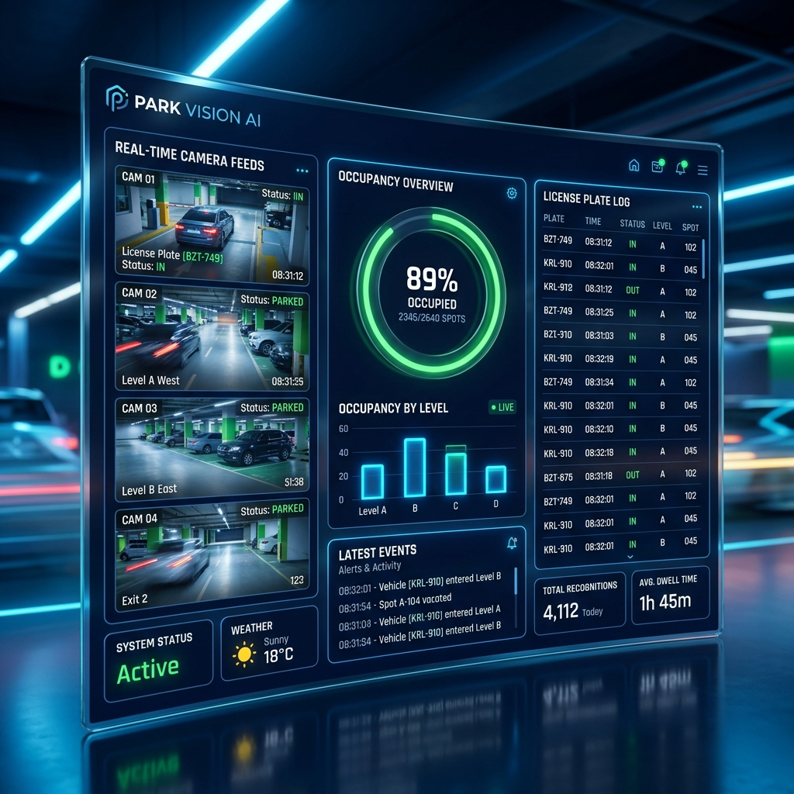

# 🚗 Camera AI — Giám sát bãi giữ xe thông minh



[](LICENSE)
[](https://www.python.org/)
[](https://fastapi.tiangolo.com/)
[](https://docs.docker.com/compose/)

> Hệ thống AI giám sát bãi xe trên **Orange Pi 4 Pro (ARM)**: nhận diện biển số VN, khuôn mặt, đếm người/xe, điều khiển cửa cuốn và cảnh báo Telegram.

## ✨ Tính năng

| Tính năng | Mô tả |
|---|---|
| 🔍 Nhận diện biển số | YOLOv2.6 + RapidOCR (biển số Việt Nam) |
| 👤 Nhận diện khuôn mặt | InsightFace, phát hiện người lạ (threshold 0.25) |
| 📊 Đếm người/xe | TripwireTracker (vạch ảo) |
| 🚪 Cửa cuốn | Tuya, Tasmota, Shelly, Sonoff, BroadLink, GPIO, MQTT |
| 📱 Telegram | Multi-bot, 2 kênh (quan trọng / thường) |
| 🎥 PTZ + WebRTC | ONVIF + Imou Open API, mobile view qua TURN |
| 🏢 Multi-site + RBAC | Nhiều bãi xe, phân quyền menu DB-driven |
| 🌐 Web Management | FastAPI + Jinja2 + HTMX + Tailwind CSS |

## 🏗️ Kiến trúc

```
RTSP Camera (Imou 2K)
    ├─► main.py (AI core: YOLO track + OCR + TripwireTracker)
    │       ├─► backend/core/database.py (PostgreSQL)
    │       └─► backend/core/telegram_service.py (cảnh báo)
    └─► frontend/ (FastAPI — quản lý hệ thống)
            ├─► routers/ (17 route handlers)
            ├─► templates/ (Jinja2)
            └─► menu_registry.py (single source of truth)
```

**Stack:** YOLOv2.6 ONNX + RapidOCR + InsightFace · FastAPI/Uvicorn · Jinja2 + HTMX + Tailwind · PostgreSQL 16 · Telegram Bot API · Tuya/Tasmota/MQTT · Docker Compose

## 🚀 Cài đặt

```bash
git clone https://github.com/satosis/yolov26-nhandien-biensoxe.git
cd yolov26-nhandien-biensoxe
cp .env.example .env          # sửa DATABASE_URL, POSTGRES_* với thông tin thực
```

**Chạy với Docker (khuyến nghị):**

```bash
docker compose up -d                          # khởi chạy
docker compose logs -f ai_core                # xem logs
docker compose --profile db_admin up -d       # kèm Adminer
```

**Chạy thủ công (không Docker):**

```bash
pip install -r backend/requirements.txt
# Terminal 1: Web Management
cd frontend && uvicorn app:app --host 0.0.0.0 --port 8000
# Terminal 2: AI Core
export PYTHONPATH=$PYTHONPATH:$(pwd)
python backend/main.py
```

> 📖 **Xem hướng dẫn chi tiết:** Xem file [INSTALL.md](INSTALL.md) để biết chi tiết các phương thức cài đặt (Ubuntu, macOS, Windows, Docker, và đặc biệt là triển khai lên **NVIDIA Jetson Nano**).

**Truy cập:**
- Chạy bằng Docker: `http://localhost:8080` (truy cập từ xa: `http://100.83.133.85:8080` hoặc `http://192.168.1.18:8080`)
- Chạy thủ công (Uvicorn): `http://localhost:8000`

## 💻 Kết nối từ xa bằng Antigravity IDE (Remote Development qua Tailscale)

Hệ thống hỗ trợ lập trình và điều khiển từ xa:
* **Máy chính (Host cố định):** Máy tính **Windows** đặt ở nhà/văn phòng — chạy server, AI core, Docker, cơ sở dữ liệu và lưu trữ toàn bộ mã nguồn.
* **Máy phụ (Client xách tay):** Máy **MacBook** đem đi lại — dùng **Antigravity IDE** kết nối từ xa vào máy Windows qua mạng riêng ảo **Tailscale** (kết nối mọi lúc mọi nơi kể cả khác WiFi hay 4G/5G).

---

### 1. Thiết lập trên Máy Chính (Windows) — Chỉ cần làm 1 lần

#### Bước 1: Cài đặt Tailscale trên Windows
1. Tải và cài đặt Tailscale: [https://tailscale.com/download/windows](https://tailscale.com/download/windows).
2. Đăng nhập cùng tài khoản Tailscale với máy Mac (`hung0913003358@...`).
3. Máy Windows đã kết nối thành công với thông số:
   - **Tên máy Windows**: `desktop-nie6arf`
   - **IP Tailscale của máy Windows**: `100.80.242.108`

#### Bước 2: Bật dịch vụ OpenSSH Server trên Windows
Mở **PowerShell với quyền Quản trị viên (Run as Administrator)** trên máy Windows và dán các lệnh sau:

```powershell
# 1. Cài đặt OpenSSH Server
Add-WindowsCapability -Online -Name OpenSSH.Server~~~~0.0.1.0

# 2. Khởi động và thiết lập tự chạy cùng Windows
Start-Service sshd
Set-Service -Name sshd -StartupType 'Automatic'

# 3. Mở cổng 22 trên Firewall Windows (áp dụng cho mọi mạng kể cả Tailscale)
netsh advfirewall firewall add rule name="OpenSSH Port 22" dir=in action=allow protocol=TCP localport=22
```

#### Bước 3: Xem tên tài khoản đăng nhập Windows
Trong cửa sổ PowerShell / CMD của Windows, gõ:
```powershell
whoami
```
*(Hệ thống sẽ trả về dạng `COMPUTERNAME\username`, bạn chỉ cần lấy phần `username` sau dấu gạch chéo).*

---

### 2. Thiết lập trên Máy Phụ (MacBook)

#### Cấu hình file `~/.ssh/config` trên Mac
Mở file `~/.ssh/config` trên máy Mac và dán nội dung sau:

```ssh
Host win-tailscale
    HostName 100.80.242.108
    User <USERNAME_MÁY_WINDOWS>
    Port 22
```

---

### 3. Cách kết nối từ Antigravity IDE trên MacBook

1. Mở **Antigravity IDE** trên MacBook.
2. Nhấn tổ hợp phím `Cmd + Shift + P` $\rightarrow$ gõ:
   ```
   Connect to SSH Host...
   ```
3. Chọn:
   - `win-tailscale`: Khi bạn mang MacBook đi ra ngoài (quán cafe, công tác, dùng 4G/khác WiFi).
   - `win-lan`: Khi MacBook ở nhà/văn phòng và bắt chung mạng WiFi với máy Windows.
4. Khi được hỏi hệ điều hành máy chủ, chọn: **Windows**.
5. Nhập mật khẩu đăng nhập của máy tính Windows.
6. Vào menu **File** $\rightarrow$ **Open Folder...** $\rightarrow$ chọn thư mục dự án trên máy Windows:
   ```
   D:\project\yolov26-nhandien-biensoxe
   ```
7. Toàn bộ mã nguồn, cửa sổ Terminal, Docker và Antigravity AI Agent sẽ xử lý trực tiếp trên máy Windows chính.

## 🗄️ Database Schema (chính)

`roles`, `users`, `sites`, `cameras`, `plate_events`, `vehicle_sessions`, `plate_whitelist`, `pending_plates`, `app_settings`, `telegram_bots`, `camera_providers`, `door_providers`, `stranger_logs`, `ocr_training_samples`, `cameras_asset`

## OCR dùng chung và phân tích video

- `backend/util/ocr_pipeline.py` dùng chung cho biển số, hóa đơn và chữ viết tay: đánh giá chất lượng, giữ ảnh gốc trước khi thử các biến thể, tiền xử lý có giới hạn bộ nhớ, chọn kết quả và tổng hợp theo thời gian. Mỗi loại OCR giữ model, quy tắc và bố cục riêng.
- Màn nhận diện mặc định chỉ trả về **người và biển số**, không tải mô hình nhận diện danh tính khuôn mặt hoặc hiển thị cửa.
- Tab **Video** tự phát và tự phân tích ngay khi chọn tệp, dùng chế độ **Theo video**. Trạng thái và nút dừng nằm gọn trong khung video; không có bảng cấu hình hoặc bước nhấn phân tích. Chọn tệp khác sẽ hủy tác vụ cũ; phát, tạm dừng và tua không tạo tác vụ trùng.
- **Theo video** tự điều chỉnh nhịp lấy mẫu theo thời gian xử lý thực tế, tối đa 8 frame/giây, để tránh tích hàng đợi khi máy chậm. OCR đọc trực tiếp các dòng biển số trên tối đa 3 crop/track, không chạy bộ tìm dòng chữ. Máy yếu có thể chỉ quét được rất ít frame và bỏ sót xe nhanh. API vẫn hỗ trợ **Chi tiết** (từng frame, thêm vùng giữa khi chưa chọn ROI) và **Nhanh** (khoảng 5 frame/giây) cho các công cụ gọi riêng.
- Worker đọc file nguyên bản, giữ timestamp và hướng xoay; mỗi track chỉ OCR tối đa 5 crop đã chọn (3 ở chế độ Theo video). Chỉ tải OCR khi có crop biển số cần đọc; các phiên OCR trong tiến trình video dùng số luồng giới hạn và tắt chờ bận. Hai lần đọc toàn biển thống nhất mới có thể ở trạng thái **Đã đọc**; một lần đọc ở trạng thái **Chưa chắc chắn**. **Không đọc được** vẫn giữ ảnh bằng chứng. Người và biển số có track riêng; người không chạy OCR. Khung vẽ trên video chỉ hiển thị gần đúng timestamp được phân tích, tránh mang khung cũ sang xe khác khi tua.
- API tác vụ: `POST /admin/detection/api/videos`, `GET /admin/detection/api/videos/{job_id}`, `GET /admin/detection/api/videos/latest`, `POST /admin/detection/api/videos/{job_id}/cancel`. Các tác vụ và ảnh kết quả được giới hạn theo người dùng và địa điểm. Khi chuyển trang rồi quay lại, tab Video tự nối với tác vụ đang chạy hoặc kết quả gần nhất. Luồng video tạo báo cáo riêng, không ghi sự kiện bãi xe/người lạ từ từng frame.
- Web xếp hàng tối đa 3 tác vụ; mỗi lần chỉ chạy một tiến trình phân tích video riêng. Trên Windows, tiến trình đó dùng ưu tiên thấp hơn web và giới hạn mặc định 2 lõi CPU/2 luồng suy luận để các trang khác vẫn phản hồi. Giới hạn file 512 MB, video 60 phút. Chạy web với **một Uvicorn worker**; trạng thái tác vụ không tiếp tục sau khi restart. File nguồn được xóa khi kết thúc/hủy; ảnh kết quả được dọn sau khoảng 1 giờ hoặc sớm hơn khi lịch sử vượt 24 tác vụ. Không cần thêm dịch vụ hàng đợi.

Kiểm thử không tải model hoặc ghi dữ liệu nghiệp vụ:

```bash
python -m unittest discover -s tests -v
```

## ⚙️ Thông số kỹ thuật

| Thông số | Giá trị |
|---|---|
| Python | 3.10 (prod), 3.11 (dev) |
| Model | `yolo26_plate_people_door_int8.onnx` (YOLOv2.6 INT8) |
| Face threshold | 0.25 |
| Stranger / pending cooldown | 60s |
| OCR sample range | confidence 0.3–0.7 |
| Remember token | `secrets.token_urlsafe(32)` |
| Data retention | 30 ngày (legal hold không xóa) |
